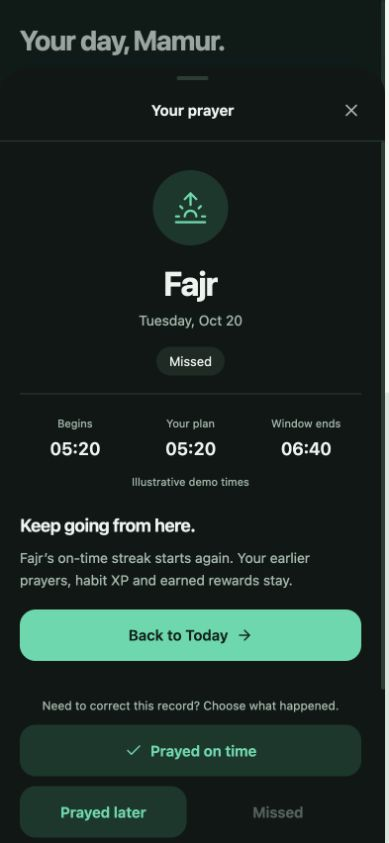
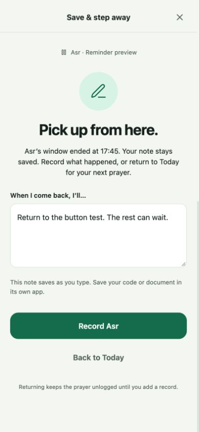
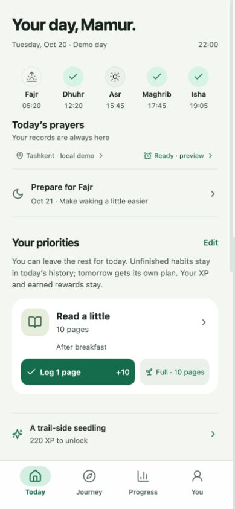
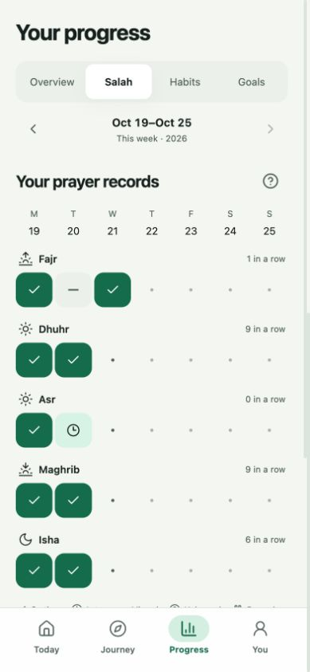

# A difficult day in RISE

> Historical 21 October 2026 rehearsal and captures. Use the isolated review build on 4174; described browser states and test counts are dated evidence. Current production scope/status is in [README.md](README.md) and [TASKS.md](TASKS.md).

You miss Fajr, lose track of time while vibecoding, and reach bedtime with most habits unfinished. RISE now helps you choose a manageable next step while keeping an honest record of what happened.

The continuous rehearsal finished the following morning with **290 XP**, Pip's scarf, earlier goal progress and reward history intact. Your usual saved profile on port 4173 was preserved.

## Try it yourself

1. Open the [separate rehearsal](http://localhost:4174/?review=1). It currently shows the next morning after this walkthrough.
2. In **Review the prototype**, select **Difficult day · one small step**, then **Load selected fixture**. This replaces only that origin's rehearsal data. Your [usual prototype](http://localhost:4173/?v=daily-life) uses a separate saved profile.
3. Use **Day checkpoint** to move through the day. This changes time, not your records. Do not reload a fixture between steps.

Review controls sit beside the phone on desktop and above it on narrow screens. The fixture starts at 08:00 on Tuesday, October 20, 2026, in Asia/Tashkent. Its earlier achievements and prayer times are explicitly illustrative. No real alarm or reminder is delivered.

## The recovery

| Moment | What to try | What RISE does |
|---|---|---|
| **08:00 · You missed Fajr** | Open the pending Fajr record and explicitly choose **Missed**. | Nothing is assumed from an empty record. After your choice, **Keep going from here** explains that this prayer's on-time streak restarts, while earlier records, habit XP and earned rewards stay. **Back to Today** gives you a clear next step. Corrections remain available. |
| **The day feels too big** | Tap **Make today lighter**. Remove English and building from priorities; keep reading. Save. | Your focus list becomes smaller. The underlying habits stay available under **My routine**, uncompleted. No XP is added or removed. One page becomes the suggested reading action; the full target remains available. |
| **12:20 · Dhuhr** | Record Dhuhr after praying. | The next prayer has its own record and streak. Missing Fajr does not erase your other prayers. |
| **15:45 → 18:00 · “Five more minutes”** | Open **Save & step away**, write “Return to the button test. The rest can wait.” and choose **I need 60 seconds to save**. While the form is open, move the checkpoint to **After Asr's window**. | The form now says **Pick up from here** and explains that Asr's window ended. Your draft stays. **Record Asr** lets you report what happened; **Back to Today** leaves it unlogged. The stale countdown and step-away command disappear. |
| **You return later** | If you prayed later, explicitly record **Prayed later**. Return to the reminder screen. | It acknowledges the actual record and keeps your work note. It no longer tells you to record a prayer you already logged. A missed or corrected record is reflected accurately too. |
| **18:00 and 19:05 · Evening prayers** | Record Maghrib and Isha after praying. | Salah stays central while the rest of Today remains available. Your records can reflect a mixed day. |
| **22:00 · Most habits remain unfinished** | Read one page and log that tiny version—or leave the habits unfinished. | The bedtime copy says you can leave the rest for today. In this rehearsal, the one-page check-in adds **10 XP** and finishes the one selected priority. Nothing automatically replaces it. Unfinished habits remain in today's history. |
| **Progress → Journey** | Open Progress, then follow **Rewards in Journey**. | The week still includes eight on-time prayers, four of seven habit actions and the earlier goal milestone. The coffee reward earned Monday is still available. Mark it enjoyed only when you have enjoyed it; RISE buys nothing. |
| **Bedtime → next morning** | Save the dated **Wednesday, Oct 21** Fajr plan. Reload, advance one local day, choose **05:35**, and explicitly record Fajr after praying. | The plan survives reload. Tomorrow receives its own scheduled habits, without yesterday's unfinished occurrences becoming extra tasks. Fajr's current on-time streak is now one; its best remains three. XP stays at 290. |

**Today** offers the next action. **Progress** explains the record. **Journey** keeps your celebrations. **You → Prayer preferences** provides the same Fajr preparation and reminder controls when you want to adjust your setup.

## What changed

The missed/later prayer screen now offers a supportive return to Today before its correction controls.

An expired save-and-stop reminder changes in place, preserving the note and avoiding an outdated instruction.

Bedtime makes room for stopping. A tiny completion counts honestly; an unfinished habit does not take away earned XP.

The calendar retains both the difficult day and the next morning's restart.

## What stayed intact

This fixture begins with **280 XP** from prior fictional habit check-ins, Monday's prayer records, a completed goal milestone, Pip's scarf and an earned coffee reward. Only the new tiny reading check-in changes XP: **280 → 290**. Prayer records, changing priorities, saving a work note, preparing for Fajr and enjoying a reward add none.

A missed or later prayer honestly breaks that prayer's current on-time streak. It does not erase previous records, best streaks, goal progress or cosmetics. A missed habit day can affect habit consistency and its current streak, but does not deduct earned XP. Explicit corrections still recompute relevant records and reward eligibility; this walkthrough does not disable those safeguards.

## Verification

The production build passed, along with **53 domain tests and 50 browser tests**. The three new recovery scenarios also passed after the final checkpoint-order adjustment. They cover the complete day, expired reminder drafts and corrections, a zero-check-in day, reload persistence and the next-day schedule.

The screens were inspected at requested 375, 393 and 430 px widths, desktop, light/dark appearances and enlarged text. The [capture manifest](.impeccable/review/recovery-day/manifest.json) records actual exported dimensions and build provenance. This is a local browser prototype, not a native alarm or physical-device test.
