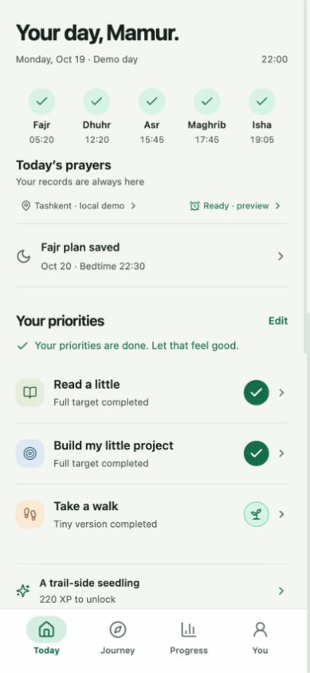
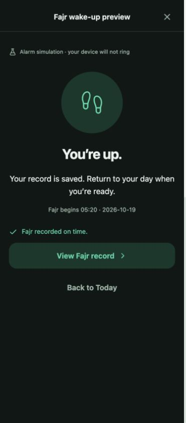
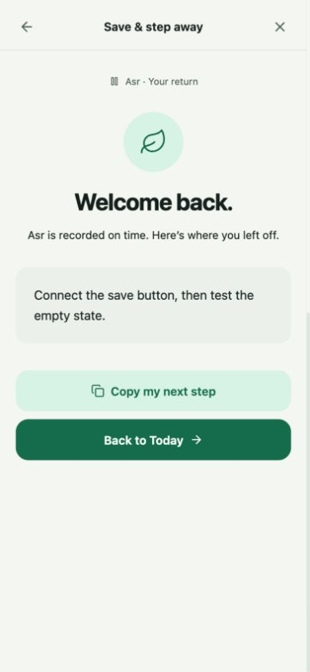
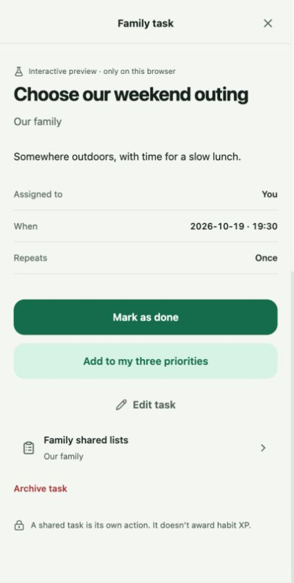
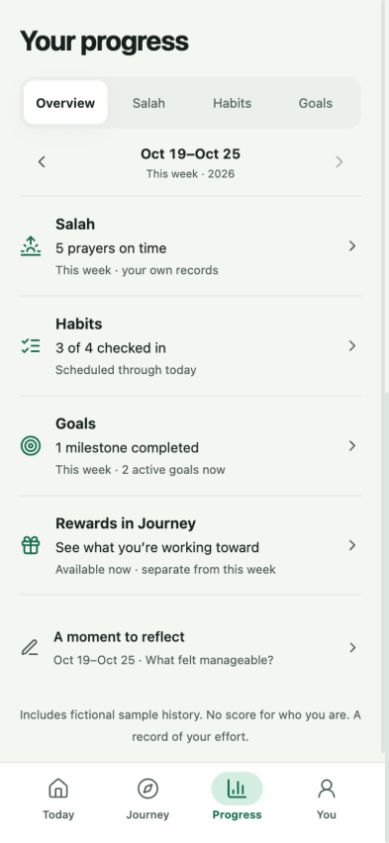
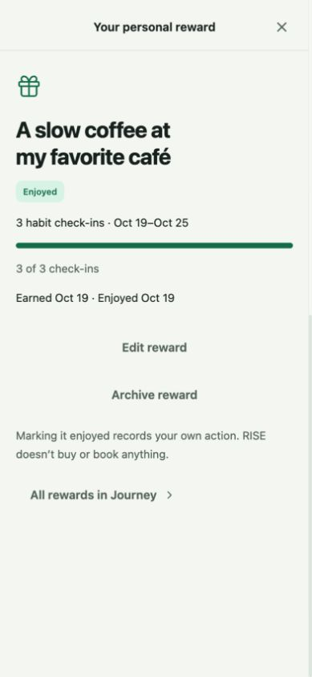
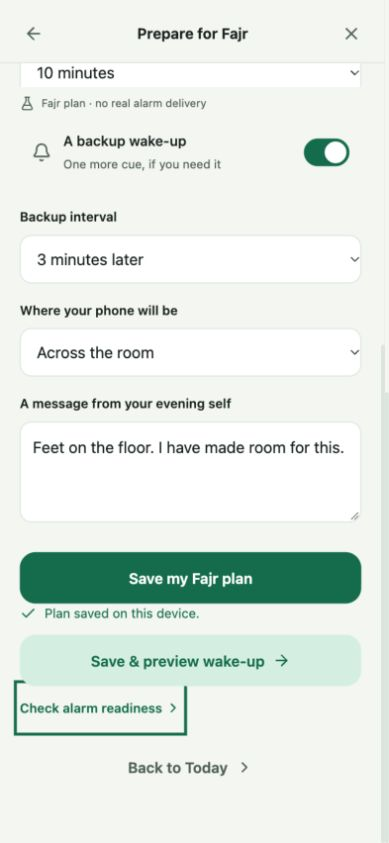

# A day in RISE: Fajr to bedtime

> Historical 21 October 2026 rehearsal and captures. Use the isolated review build on 4174; described browser states and test counts are dated evidence. Current production scope/status is in [README.md](README.md) and [TASKS.md](TASKS.md).

The four tabs have distinct jobs: **Today** is where you act, **Journey** is where you celebrate, **Progress** is where you understand your records, and **You** holds prayer preferences, family, squads and settings.

This walkthrough was completed as one continuous day, with a reload at the end. Your existing profile on port 4173 was preserved. Port 4174 is a shared rehearsal origin and now holds the difficult-day next morning. Select **Full day · Fajr to bedtime** and **Load selected fixture** there to replay this completed-day example; the captures below retain its original history.

## Replay it yourself

1. Open [the full-day rehearsal](http://localhost:4174/?review=1).
2. In **Review the prototype**, select **Full day · Fajr to bedtime**, then **Load selected fixture**. This replaces only the rehearsal browser origin's local data. Keep your usual profile at [the main prototype](http://localhost:4173/?v=daily-life).
3. Use **Day checkpoint** to move through the times below. It changes the demo clock while retaining your actions and drafts. Do not reload a fixture between checkpoints.

Review controls appear beside the phone on desktop and above it on a narrow screen. The fixture uses a labelled fictional Monday, October 19, 2026, in Asia/Tashkent. Times are illustrative; alarms and reminders are local previews and will not ring.

## The day

| Checkpoint | What to try | How the tabs connect |
|---|---|---|
| **05:10 · Wake-up** | Stop the primary alarm, preview the backup, then tap **I'm up**. You see “No prayer recorded” and **View Fajr time**, because Fajr begins at 05:20. | Waking is preparation. It does not check off salah or award XP. |
| **05:35 · After Fajr** | Tap **Record Fajr**, choose **Prayed on time**, then go back. The acknowledgment now says “Fajr recorded on time.” Tap **Back to Today**. | The prayer strip reflects your explicit record. |
| **08:00 · Morning priorities** | Log **10 pages** of reading. Claim Pip's linen scarf when the unlock appears. Log the **tiny two-minute walk** if that is what you managed. | Today handles the actions; Journey retains the scarf and shows the next unlock. |
| **12:20 · Dhuhr** | Tap Dhuhr in Today's prayer strip and record it after praying. | No extra dashboard or separate checklist is needed. |
| **15:35 → 15:45 · Pause vibecoding** | From **You → Prayer preferences → Prayer reminders**, preview save-and-stop. Save “Connect the save button, then test the empty state.” Step away. At 15:45, explicitly record Asr and use **Back to Today**. | The same reminder flow works whether you entered from Today or You. Your return note stays available. Save editor files in your editor. |
| **After Asr · Finish a small session** | Log the full **20-minute building session**. | All three priorities stay completed. Nothing automatically replaces them. The third habit check-in earns the demo coffee reward. |
| **17:45 and 19:05 · Evening prayers** | Record Maghrib and Isha after praying. | Today keeps the prayer strip and tomorrow's Fajr preparation close together. |
| **20:30 · Family** | Expand **Family** on Today. Open **Choose our weekend outing → Family shared lists → For the week**. Check **Apples**, go back to the task and mark it done. | **You → Family** also reaches the same shared space. Family work changes task/list records, without adding habit XP. |
| **20:30 · Review and celebrate** | Open **Progress**. In Goals, explicitly complete **Build the first working screen**, then return to Overview. Follow **Rewards in Journey**, open the earned coffee and tap **Mark as enjoyed** when you have enjoyed it. | Progress shows five prayers, three of four habit actions and one milestone. Journey retains the enjoyed reward in history. |
| **22:00 · Bedtime** | Open **You → Prayer preferences → Prepare for Fajr**, or Today's Fajr row. Save the dated **Tuesday, Oct 20** plan: bedtime 22:30, wake 05:10, backup three minutes later, phone across the room. | “Plan saved on this device” confirms the save. **Back to Today** shows the saved plan beside your completed day. |

The remaining learning habit stays available under **My routine**. Completing your chosen priorities is allowed to feel finished.

## What a completed day looks like

## The important handoffs

**Waking → prayer.** The alarm acknowledgment now reflects an explicit prayer record or correction and provides a direct return to Today.

**Work → prayer → work.** The return screen keeps your next step and sends you to Today, including when the reminder was opened from You.

**Task → shared list.** A family task now opens its own family's Lists section directly, with a working back path.

**Progress → reward.** The evening overview separates prayer records, habit consistency and goal movement. The reward link opens Journey.

**Bedtime → tomorrow.** The plan names its target date and retains a saved confirmation. At enlarged text sizes, clock digits remain together and the sheet heading has room to wrap.

## What was checked

The rehearsal began with 230 lifetime XP from labelled prior fictional history. Reading full (+20), walking tiny (+10) and building full (+20) ended at **280 XP**. Prayers, the family task, shopping item, goal milestone, clock changes and reward enjoyment added none. The coffee condition is three check-ins in this explicit fixture only.

Five prayers, three check-ins, one family task, one shopping item, one explicit milestone, the claimed scarf, enjoyed coffee and next Fajr plan survived reload. Tomorrow's prayers remained unrecorded.

The production build and **100 automated tests** passed. Screens were inspected at the requested 375, 393 and 430 px widths, desktop, dark appearance and enlarged Uzbek text. Actual exported image dimensions and build provenance are recorded in the [capture manifest](.impeccable/review/full-day/manifest.json). This remains a local browser prototype; real alarm delivery and physical-device behavior are outside this walkthrough.
